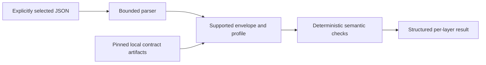

# Ontology Companion Contracts: architecture and roadmap

The local runtime validates draft exchange envelopes and separate Code/Context profiles offline. It reads an explicitly selected JSON file and prints structured results; an optional stdio adapter is implemented for manual host configuration. Local synthetic tests have passed. Public plugin installation, migration execution, real-data use, and actual host integration remain unsupported or pending.

Code and Context use different payload profiles. Shared exchange metadata does not require every Code symbol to become an approved memory record, and a Context approval does not turn static Code evidence into observed runtime behavior. Preserve legacy identifiers and vocabulary in mapping fixtures.

The local preview does not implement a generic remote JSON Schema resolver, production auth service, automatic migration executor, or public hosted MCP. Compatibility claims require a tested producer/consumer pair. The wider contract design is recorded in [CONFORMANCE](CONFORMANCE.md) and [ARCHITECTURE](ARCHITECTURE.md); those documents must not be read as a completed feature catalogue.

## Independent products

Contract artifacts provide a versioned interchange boundary. Code, Context, and Contracts remain separate installation and permission domains. A consumer pins or vendors the tested artifact; it need not install the Contracts plugin. Sharing schemas does not grant database access, permission inheritance, automatic tool routing, or a platform dependency mechanism.

The existing Code product is a read-only reference during this work. Its public documentation structure was checked at revision `be1699f784e48433a692bbfaa1c6c1d6f2b489b0` on 2026-09-05. [Code Ontology Companion](https://github.com/battle-doll/code-ontology-companion) was not modified.

## Release path

| Stage | Required evidence |
| --- | --- |
| P0 | Actual repository, platform, permission and host baseline |
| P1a | Draft contracts exercised by synthetic Code mapping and Context consumer |
| P1b | Versioned artifacts and explicit compatibility fixtures |
| P2 | Product workflow and independent-installation checks |
| P3 | Each advertised OS and actual host tested; submission and publication tracked separately |
| P4 | Optional Code bridge with separately authorized changes if needed |
| P5 | Shared pure execution code only after two consumers demonstrate reuse |

The target OS family is macOS, Windows, and Linux. Consult [platform evidence](PLATFORMS.md), [versioning](VERSION_POLICY.md), and [release/rollback policy](RELEASE_POLICY.md). A configured CI matrix is not proof that its jobs ran.
